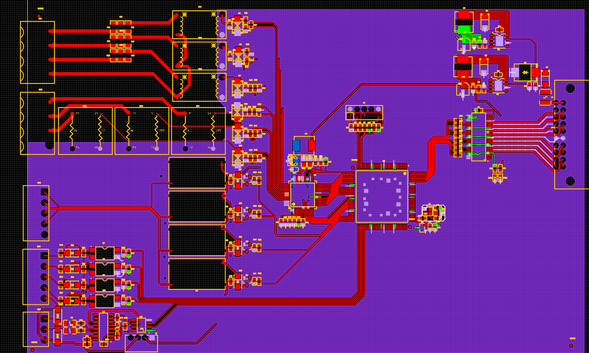
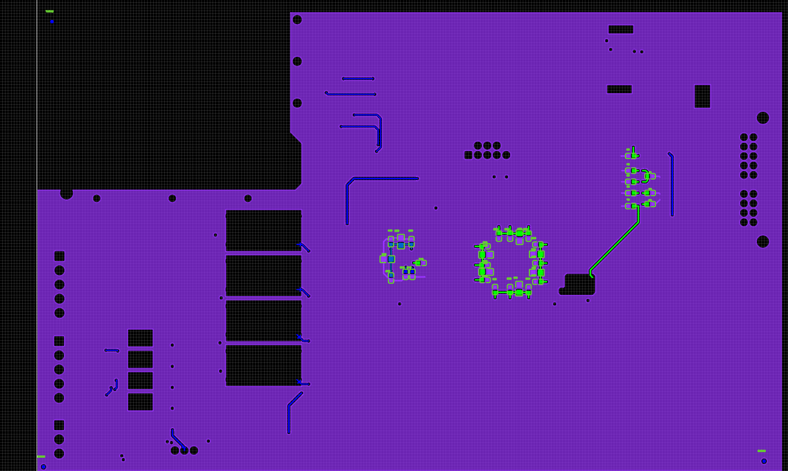

# Mixed-Signal Controller PCB

> Evidence level: **E2** - readable design exports, BOM, DRC, Gerber, and manufacturing-file consistency checks
>
> Hardware status: **not physically built or tested**
>
> Portfolio status: reviewed local candidate prepared for the `My_GitHub` portfolio branch

## Overview

This project packages an author-maintained, seven-page mixed-signal controller board as a reproducible engineering portfolio case. The board combines power and interface protection, LVDS I/O, CPLD control, current and voltage sensing, multi-channel ADC acquisition, digital I/O, and isolated serial communication.

The PCB is a four-layer board measuring approximately **200.0 mm x 144.4 mm**. The final design snapshot contains:

| Metric | Value |
|---|---:|
| Schematic pages | 7 |
| Schematic parts | 224 |
| Schematic nets | 258 |
| PCB placed objects | 224 |
| PCB pads | 822 |
| Routed line primitives | 1,441 |
| Via objects | 1,247 |
| Copper-pour boundaries | 14 |
| Copper layers | 4 |

## System organization

| Page | Function |
|---|---|
| `1_POWER` | Power distribution and interface protection |
| `2_LVDS` | LVDS signal routing and termination |
| `3_CPLD` | CPLD logic and control interface |
| `4_CTPT` | Current and voltage sensing channels |
| `5_ADC` | Multi-channel ADC acquisition |
| `6_DIDO` | Digital input and output channels |
| `7_COMMUNICATION` | Isolated RS-232/TTL communication |

The complete schematic set is available as a [single PDF](assets/schematic.pdf) and as seven page PNGs under [`assets/schematic-pages/`](assets/schematic-pages/). The PDF has been reordered from the EDA-native export sequence into the logical order above.

## PCB views

| Top | Bottom |
|---|---|
|  |  |

The colored images are cropped official EasyEDA viewport captures. The repository also includes same-source geometry SVGs:

- [Top actual-readback SVG](pcb/top-actual.svg)
- [Bottom actual-readback SVG](pcb/bottom-actual.svg)
- [Top assembly overlay](pcb/top-assembly.png)
- [Bottom assembly overlay](pcb/bottom-assembly.png)

The auxiliary SVG files document component envelopes, pads, and silkscreen placement. They are not a routing render and do not replace the official capture or native DRC.

## Engineering evidence

| Check | Result |
|---|---|
| Native PCB DRC | `passed: true`, 0 violations |
| DFM reconstructed audit | Complete coverage; 41 errors and 236 warnings |
| Silkscreen flipped/reversed | 191 before cleanup -> 0 |
| Silkscreen over exposed pads | 59 before cleanup -> 28 |
| Schematic native DRC | 0 fatal, 0 errors, 21 warnings across seven pages |
| Schematic bridge/orphan check | 0 bridge, 0 orphan |
| BOM vs Pick-and-Place | 224 / 224 designators, exact set match |
| Gerber | 18 archive entries; millimeter units; closed outline; top/bottom and both inner copper layers; three drill files |

The 41 DFM errors are clearance calculations reported as `6.0 mil < 6.0 mil`; the native PCB DRC remains clean. They are retained as a precision-boundary finding rather than concealed or "fixed" by moving routed copper.

## What was improved for the portfolio release

- Created a sanitized four-layer public working copy from the author's historical EDA project.
- Replaced the legacy competition title area with an English personal portfolio profile on every page.
- Removed exposed name, participant identifier, school/competition metadata, and internal project naming from the exported schematic pages.
- Planned and applied 100 top-side designator positions, then normalized remaining silk rotations.
- Reduced flipped/reversed PCB designators from 191 to 0 and over-pad designators from 59 to 28.
- Exported official schematic, PCB, Gerber, BOM, and Pick-and-Place artifacts.
- Reordered the PDF pages for reading while preserving the original EDA-native export for internal evidence.

No component, board outline, layer count, power topology, or routed copper was intentionally redesigned in this pass.

## Reproducible package

- [`assets/schematic.pdf`](assets/schematic.pdf)
- [`pcb/top-official.png`](pcb/top-official.png)
- [`pcb/bottom-official.png`](pcb/bottom-official.png)
- [`manufacturing/gerber.zip`](manufacturing/gerber.zip)
- [`manufacturing/bom.tsv`](manufacturing/bom.tsv)
- [`manufacturing/placement.csv`](manufacturing/placement.csv)
- [`evidence/schematic-summary.json`](evidence/schematic-summary.json)
- [`evidence/pcb-drc.json`](evidence/pcb-drc.json)
- [`evidence/pcb-dfm-check.json`](evidence/pcb-dfm-check.json)
- [`evidence/gerber-validation.json`](evidence/gerber-validation.json)
- [`evidence/bom-placement-consistency.json`](evidence/bom-placement-consistency.json)

## Limitations

- There is no physical board, so this repository makes no claim about power-up, ripple, thermal performance, EMC, yield, or long-term reliability.
- The layout lint reports two package-envelope overlaps at `MARK4/MARK5 x U4`; these were not moved because the approved scope excluded component and routing changes.
- Twelve `wire-through-body` findings and 257 `pin-exit-direction` layout findings remain in the reconstructed schematic check. Native schematic DRC has no fatal/error items and the bridge/orphan check is clean.
- The DFM audit still reports 28 silkscreen-over-pad warnings, 24 via-in-pad warnings, six single-layer vias, and two power-not-poured warnings. They are documented rather than hidden.
- `6_DIDO` reopened successfully, but one component-inventory readiness query timed out. Its title-block and text contents were read back directly after saving; the issue is recorded as a tool-runtime limitation.
- The raw EasyEDA project, native `.epro2`, history, embedded project image, and third-party libraries are deliberately excluded.

## 中文摘要

本项目将一块个人历史七页混合信号控制板整理为适合求职展示的完整工程案例。公开包包含七页原理图、PCB 正反面、毫米制 Gerber、BOM、贴装坐标和静态检查证据；BOM 与 P&P 的 224 个位号完全一致。本次只做脱敏、丝印小修和导出整理，没有大改电路、板框、叠层或主要布线。当前没有实物，因此不声称上电、纹波、热测试或长期可靠性验证。

来源和修改边界见 [`SOURCE.md`](SOURCE.md)，证据索引见 [`EVIDENCE.md`](EVIDENCE.md)，复核与保留问题见 [`REVIEW.md`](REVIEW.md)。
