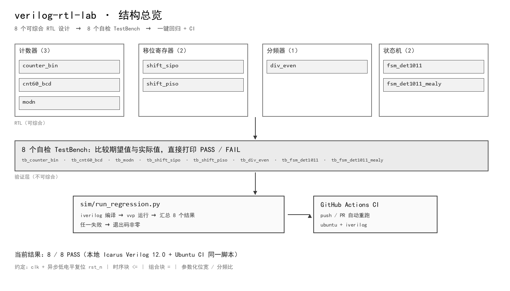
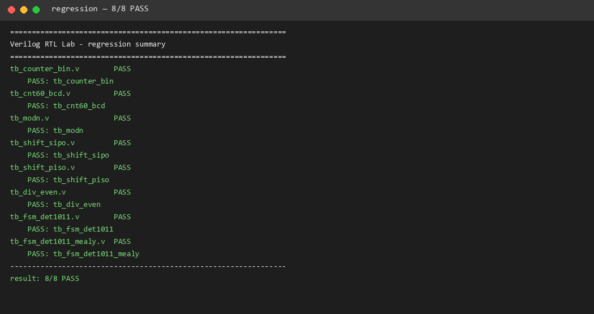
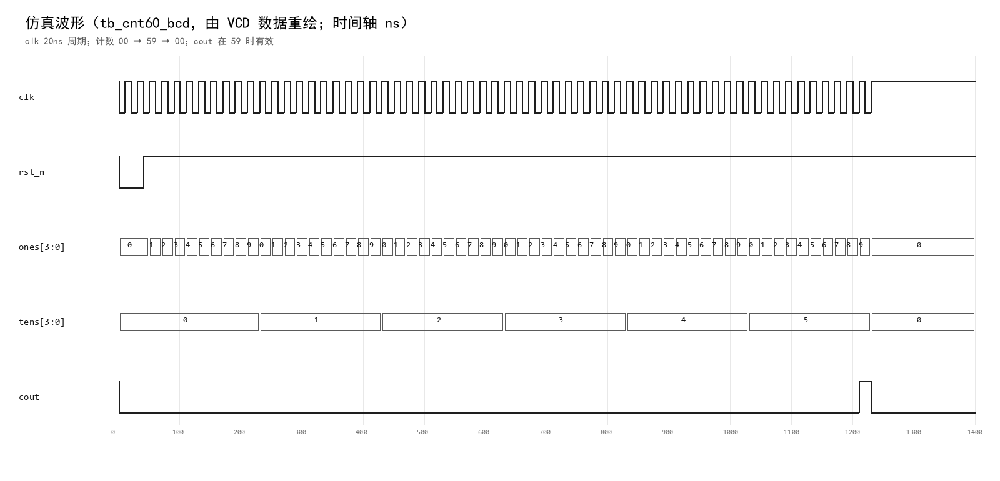

# verilog-rtl-lab

[](https://github.com/320MARCUS/320MARCUS/actions/workflows/rtl-regression.yml)

> **Verilog RTL design & self-checking verification lab** — 8 个从课程练习整理而来的 RTL 设计，每个配自检 TestBench，一条命令跑完全部回归。
> 8 synthesizable RTL designs (counters, shift registers, clock divider, sequence detectors) with self-checking testbenches and one-command regression.

| | |
|---|---|
| **方向** | 数字电路 / FPGA / 硬件验证 |
| **时间** | 2026.10 |
| **角色** | 独立完成 |
| **状态** | 已完成 |

## 1. 项目背景

课程练习散落在一次次作业提交里：代码能跑，但既无法复现、也无法证明"改坏了没有"。本项目把课程里的 8 个典型设计整理成统一风格的可综合 RTL，并为每个设计补充**自检式 TestBench** 与**一键回归**——每次修改后一条命令即可确认全部设计仍然正确。

整理过程中还伴随一套课程资料自动化工具（PDF 版面解析 → 讲义重排 → 应试速查），本文不附课程原始资料；本仓库只包含原创代码与自制示例。

## 2. 方案设计

### 2.1 整体框图



```text
rtl/  8 个可综合设计  ──►  tb/  8 个自检 TestBench  ──►  sim/run_regression.py
       计数器×3                  （比较期望值 + PASS/FAIL）        │
       移位寄存器×2                                              ▼
       分频器×1                                         GitHub Actions CI
       状态机×2
```

### 2.2 技术选型

| 项目 | 选型 | 理由 |
|---|---|---|
| 仿真器 | Icarus Verilog（`iverilog` / `vvp`） | 开源、轻量、命令行可脚本化 |
| 语言风格 | Verilog-2001（可综合子集） | 课程与企业 RTL 的公共子集 |
| 回归脚本 | Python 3（仅标准库） | 零依赖，CI 与本地一致 |
| CI | GitHub Actions（ubuntu-latest） | 每次 push 自动编译并跑回归 |

### 2.3 设计要点

- **统一约定**：所有时序模块使用 `clk` + 异步低电平复位 `rst_n`；时序块只用非阻塞 `<=`；组合块只用阻塞 `=`。
- **参数化**：计数器/移位寄存器/分频器均用 `parameter` 定义位宽或分频比，避免复制粘贴。
- **回退逻辑**：序列检测器按"新串的最长后缀 = 目标序列前缀"逐位推演，重叠检测写进 TestBench 断言。

## 3. 设计说明

| 模块 | 功能 | 关键点 |
|---|---|---|
| `counter_bin` | 参数化二进制计数器 | 满量程自动回绕、同步使能 |
| `cnt60_bcd` | 60 进制 BCD 计数器 | 个位/十位分离、59 进位输出 |
| `modn` | 参数化 N 进制计数器 | 复位 > 装载 > 计数的优先级链 |
| `shift_sipo` | 串入并出移位寄存器 | 高位先入、拼接实现移位 |
| `shift_piso` | 并入串出移位寄存器 | 高位先出、装载控制 |
| `div_even` | 参数化偶数分频 | 每 DIV/2 拍翻转 → 50% 占空比 |
| `fsm_det1011` | "1011" 序列检测（Moore） | 5 状态、允许重叠 |
| `fsm_det1011_mealy` | 同功能 Mealy 版 | 输出提前一拍、状态少一个 |

## 4. 软件结构

```text
verilog-rtl-lab/
├── rtl/            # 8 个 RTL 设计（可综合）
├── tb/             # 8 个自检 TestBench
├── sim/            # run_regression.py：编译 + 运行 + 汇总
├── docs/
│   ├── img/        # 架构图、回归输出、波形图
│   └── talk-3min.md
└── LICENSE
```

> CI 说明：本仓库为多项目单仓（monorepo），GitHub Actions 只读取仓库根 `.github/workflows/`。本项目的回归 workflow 是仓库根的 `rtl-regression.yml`（按 `projects/verilog-rtl-lab/**` 路径过滤触发）。

## 5. 如何复现

```bash
# Ubuntu / WSL
sudo apt-get install -y iverilog
python3 sim/run_regression.py
```

脚本会依次编译 `rtl/` 与对应的 `tb/`，运行仿真并打印汇总；任一测试失败时退出码非零。

## 6. 测试结果

当前回归结果：**8/8 PASS**。





| 设计 | 验证内容 | 判据 |
|---|---|---|
| counter_bin | 复位值、0→15 逐拍计数、回绕、使能保持、异步复位 | 每个时钟沿的计数值与期望一致 |
| cnt60_bcd | 00→59→00 全程、进位输出 | 每一拍的 BCD 值 + cout 电平 |
| modn | 0→9 循环、装载优先、使能保持 | 计数/装载后的 q 与 cout |
| shift_sipo | 8 位串入（高位先入） | 8 拍后 dout 等于输入字节 |
| shift_piso | 装载 + 8 拍串出 | 每拍 dout 等于对应位 |
| div_even | 每 2 拍翻转（DIV=4） | clk_out 逐拍期望值 |
| fsm_det1011 | 1011 检测、重叠（1011011）、复位 | sout 在完成态为 1 |
| fsm_det1011_mealy | 当拍输出、撤销、复位 | din=1 当拍 sout=1 |

## 7. 遇到的问题与解决

1. **60 进制看不到 19→20** —— 现象：只跑十几拍就检查，进位从未发生。原因：仿真时长不足、且在时钟沿同一时刻采样导致竞争。解决：TestBench 跑满 60 拍，并在 `posedge clk` 后 `#1` 再采样；逐拍断言 BCD 值。
2. **"1011" 重叠检测丢失** —— 现象：输入 `1011011` 只检测到一次。原因：状态机完成态的回退写错（`s3` 收到 0 时错误地回到初始态）。解决：按"最长后缀 = 目标序列前缀"重新推演（`1010` 的后缀 `10` 是有效前缀 → 回 `s2`），并在 TestBench 中固化重叠序列断言。
3. **Moore 与 Mealy 的采样时机** —— 现象：同一 TestBench 写法下 Mealy 版"晚了一拍"。原因：Mealy 输出是组合逻辑，输入变化的当拍就有效，而 Moore 要等状态寄存器更新。解决：Mealy 的 TB 在 `negedge` 驱动输入后立即断言输出，Moore 的 TB 在 `posedge` 后断言。

## 8. 可改进之处

- 目前只做**功能仿真**：未包含综合、时序约束与跨时钟域（CDC）检查；后续可加 Yosys 综合与门级仿真。
- 参数边界（如 `N=1`、`WIDTH` 不足）可在编译期加断言或文档约束。
- 可补充 Verilator / cocotb 的对照验证，或加入覆盖率统计。

## 9. 许可证

本项目采用 [MIT 许可证](LICENSE)。

## 参考资料

- 学习过程中参考的教材：《Verilog HDL 数字系统设计》（黄继业等）——仅作学习参考，本仓库代码为独立实现。
- Icarus Verilog 文档：<https://steveicarus.github.io/iverilog/>
